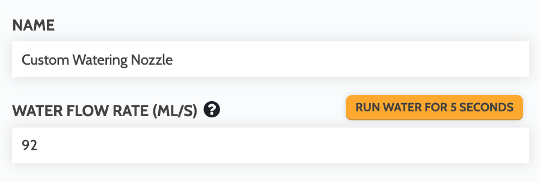

# dismount_tool()

**Dismounts the currently mounted tool** into its assigned slot, taking into account the slot's direction. The tool slot must be stationary (`mount_stage = 0`) and have a slot direction.



```lua
-- Dismount the currently mounted tool
dismount_tool()

-- It is recommended to find home after dismounting tools
-- to stage FarmBot for future operations
find_home()
```

# dispense(mL, params?)

**Dispenses the given amount of liquid in milliliters**. Defaults to using the tool with type "watering_nozzle", its **WATER FLOW RATE (ML/S)** value, and the solenoid valve operated by pin `8`.

```lua
-- Dispense 100 mL of water using default values
dispense(100)
```

The optional `params` argument can select a tool by `tool_name` instead of the default watering nozzle, using that tool's **WATER FLOW RATE (ML/S)** value. It can also override which `pin` to operate.

```lua
-- Dispense 200 mL of fertilizer using a custom tool operated by pin 7
dispense(200, {tool_name = "Custom Watering Nozzle 2", pin = 7})
```

```lua
-- Dispense 300 mL of water with the default watering nozzle, but using a solenoid valve operated by pin 10
dispense(300, {pin = 10})
```



# get_tool(params)

**Get a tool** by the given `id`, `type`, or `name`. Returns a table with the tool's `id`, `type`, `name`, `utm_mountable`, `effector_offset_x`, `effector_offset_y`, `effector_offset_z`, and `flow_rate_ml_per_s`. Returns `nil` if no matching tool exists.



```lua
-- Get a tool by its ID
tool = get_tool({id = 123})
if tool then
  toast(tool.name)
end
```

```lua
-- Get a tool by its type
tool = get_tool({type = "seeder"})
if tool then
  toast(tool.name)
end
```

```lua
-- Get a tool by its name
tool = get_tool({name = "Watering Nozzle"})
if tool then
  toast(tool.flow_rate_ml_per_s)
end
```

# get_slot_for_tool(params)

**Get a tool slot** by the given tool `id`, `type`, or `name`. Returns a table with the tool slot's `x`, `y`, `z`, `tool_id`, `pullout_direction`, `mount_stage`, `mount_offset_x`, `mount_offset_y`, and `mount_offset_z`.

Returns `nil` if no matching tool or assigned slot exists. Returned coordinates are stored slot coordinates; mounting offsets are not applied.

```lua
-- Get a tool slot by its tool ID
slot = get_slot_for_tool({id = 123})
if slot then
  toast(slot.x)
end
```

```lua
-- Get a tool slot by its tool type
slot = get_slot_for_tool({type = "seeder"})
if slot then
  toast(slot.x)
end
```

```lua
-- Get a tool slot by its tool name
slot = get_slot_for_tool({name = "Watering Nozzle"})
if slot then
  toast(slot.x)
end
```

# mount_tool(tool)

**Mounts the given tool** and pulls it out of its slot, taking into account the slot's direction. The tool slot must be stationary (`mount_stage = 0`) and have a slot direction.



```lua
-- It is recommended to find home before mounting tools
-- to ensure accuracy of movements
find_home()

-- Add a Location variable named "Tool" to the sequence
-- and select the tool you wish to mount
tool = variable("Tool")

-- Because tools themselves do not have coordinates, FarmBot
-- will look up which slot the chosen tool has been assigned
-- to and use the slot's coordinates in the mount_tool() function
mount_tool(tool)
```

You may also simply mount a tool by its name:

```lua
-- Mount a tool by name
mount_tool("My Tool")
```

# verify_tool(params?)

**Verifies if a tool is mounted to the UTM** by checking the UTM's tool verification pin as well as the **MOUNTED TOOL** field in FarmBot's state tree. Returns `true` if a tool is mounted or `false` if no tool is mounted.

If an `id`, `type`, or `name` is provided in the `params` table, `verify_tool` returns `false` if the mounted tool does not match. All provided fields must match.





```lua
-- Exit sequence if tool verification fails (no tool)
if not verify_tool() then
  return
end
```

```lua
-- Exit sequence if tool verification fails (no seeder tool)
if not verify_tool({type = "seeder"}) then
  return
end
```

# get_mounted_tool()

Convenience function for `get_tool({id = get_device("mounted_tool_id")})`. Returns the tool selected in the **MOUNTED TOOL** field, or `nil` if no tool is selected or the tool cannot be found.

```lua
local mounted_tool = get_mounted_tool()
if mounted_tool then
  toast(mounted_tool.name)
end
```

# water(plant, params?)

**Moves to and waters the given plant** based on its age and assigned watering curve.





```lua
-- Get the "Plant" variable from the sequence
plant = variable("Plant")

-- Water the plant based on its age and watering curve
water(plant)
```

Under the hood, the `water()` function makes a call to `dispense()`. If provided, the `params` argument will be passed into the `dispense` call to override its default values. See the [dispense() docs](#dispenseml-params) for more information.

```lua
-- Get the "Plant" variable from the sequence
plant = variable("Plant")

-- Water the plant based on its age and watering curve, using a solenoid valve operated by pin 10
water(plant, {pin = 10})

-- Use a named nozzle for both movement offsets and dispensing flow rate
water(plant, {tool_name = "Custom Watering Nozzle 2", pin = 7})
```

# resolve_tool_move(params)

**Calculates movement coordinates for a tool's end effector**, accounting for the tool's effector offsets and its slot's mounting offsets. Returns a new table suitable for passing to [move()](movements.md#moveargs), without moving FarmBot.

Accepts the same parameters as [move()](movements.md#moveargs), plus `id`, `name`, or `type` to select the tool using the same fields as [get_tool()](#get_toolparams). The supplied coordinates specify the desired position of the tool's end effector.

For each supplied coordinate, the result is calculated as:

```text
resolved coordinate = target - mounting offset - effector offset + offset
```

Mounting offsets come from the tool's assigned slot and depend on its `mount_stage`:

|Mount stage|Mounting offsets applied|
|-----------|------------------------|
|`0` (stationary)|None.
|`1` (gantry)|X.
|`2` (cross-slide)|X and Y.
|`3` (Z-axis)|X, Y, and Z.

```lua
-- Calculate a target for a tool named "Seeder" without moving FarmBot
local target = resolve_tool_move({
  name = "Seeder",
  x = 100,
  y = 200,
  z = -50,
  offset = {z = 5},
  safe_z = true
})

-- Inspect the resolved coordinates before moving
toast("Resolved Z coordinate: " .. target.z)
move(target)
```

For example, with a stationary slot, an `effector_offset_z` of `-30`, a target `z` of `-50`, and an `offset.z` of `5`, the resolved Z coordinate is `-15`.

# move_with_tool(params)

**Moves a tool's end effector to the given target**, accounting for effector and mounting offsets. Equivalent to `move(resolve_tool_move(params))`. Accepts the same parameters as [resolve_tool_move()](#resolve_tool_moveparams).

```lua
-- Position the watering nozzle's end effector above a plant
local plant = variable("Plant")
move_with_tool({
  type = "watering_nozzle",
  x = plant.x,
  y = plant.y,
  z = plant.z + 25,
  speed = 50,
  safe_z = true
})
```

```lua
-- Move only the seeder's end effector to an absolute X coordinate
move_with_tool({name = "Seeder", x = 100})

-- Move 10 mm along Y relative to the current position
-- Relative-only moves do not apply effector or mounting offsets
move_with_tool({name = "Seeder", offset = {y = 10}})
```
